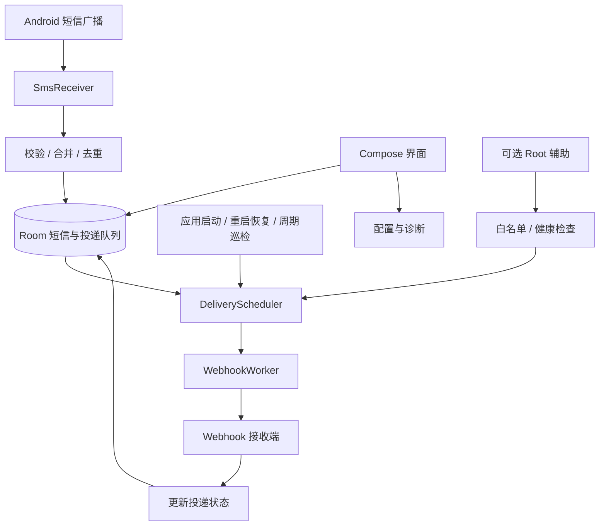

# Android SMS Webhook 原生开发文档

更新日期：2026-10-29。

本文保留整体设计和后续扩展约定。项目已实现 0.1.0 开发版的短信接收、加密存储、Webhook、过滤规则、重试恢复及 Root 白名单诊断，主要链路已在 Android 16 模拟器验证，尚未完成真机长期保活验证。当前功能与数据模型以 [开发版使用说明](开发版使用说明.md) 和 [实现与验证记录](实现与验证记录.md) 为准；下文完整多实体模型、历史补偿、Direct Boot 和看门狗属于后续设计目标。

## 1. 目标与范围

在用户自己的 Android 设备上接收短信，按照配置发送至 Webhook。设备有 Root 权限，但接收、保存和补发功能首先通过标准 Android API 实现，Root 作为可关闭的增强能力。

首版实现：

1. 接收新短信，保存发送方、正文、时间和可获取的 SIM 信息。
2. 配置一个通用 JSON Webhook，支持 Bearer Token 和可选 HMAC 签名。
3. 本地持久化后发送，断网、超时或进程退出后可以恢复。
4. 展示待发送、已发送、重试中和需处理的记录，支持手动重试。
5. 应用重新打开、系统重启后恢复队列调度。
6. 提供权限、省电配置、最近执行时间和 Root 状态诊断。
7. 在用户启用后应用 Root 增强配置，支持卸载辅助脚本及恢复配置。

后续扩展：发送方/关键词规则、多 Webhook、服务商模板、历史短信补偿、首次解锁前缓存、Root 看门狗。它们不作为第一阶段跑通链路的前置条件。

不纳入首版：发送短信、修改系统短信库、接管默认短信应用、MMS、RCS，以及将应用直接改装为系统应用。

可靠性目标针对“应用已经成功接收并写入本地队列”的消息。关机、无信号、系统未投递、首次授权之前和落盘前崩溃等情况，不能仅靠投递队列解决。

## 2. 技术栈与版本基线

| 层次 | 选择 | 用途 |
| --- | --- | --- |
| 语言 | Kotlin | 接收、投递、恢复和界面逻辑 |
| 界面 | Jetpack Compose + Material 3 | 配置、记录和诊断 |
| 异步 | Coroutines + Flow | 有界后台操作、状态订阅 |
| 本地数据库 | Room + KSP | 短信、投递状态和幂等约束 |
| 后台调度 | WorkManager + CoroutineWorker | 持久任务、失败补发、巡检 |
| HTTP | OkHttp | 超时、TLS、请求和取消 |
| 序列化 | kotlinx.serialization | 生成稳定的 JSON 数据 |
| 配置 | DataStore | 开关、过滤规则和非敏感配置 |
| 密钥 | Android Keystore | 加密 Token、签名密钥和本地敏感字段 |
| Root | 独立 RootController 接口 | 封装 su、白名单和辅助组件生命周期 |
| 依赖管理 | Gradle Kotlin DSL + Version Catalog | 固定版本、统一管理依赖 |

当前基线：`minSdk = 26`、`compileSdk = 37`、`targetSdk = 36`。目标设备为 Android 16（API 36），主要使用 API 36 模拟器验证。保留 compileSdk 37 以复用现有 SDK 和已验证的模板依赖，不意味着最低安装版本为 Android 17；使用高版本 API 时仍需进行运行时版本判断。最低支持 Android 8.0，未来提升 targetSdk 至 37 时单独验证短信保护等行为变化。

当前工程沿用 Android Studio 模板生成的 AGP 9.5.0、Gradle Wrapper 9.6.0、JDK 25 和 Compose 编译器插件 2.2.10，版本以工程配置为准；这些工具与手机 Android 版本无需使用相同数字。AGP 9 使用内置 Kotlin，不重复应用 `org.jetbrains.kotlin.android`；Compose 编译器插件需与实际 Kotlin 版本匹配。Room/KSP 等依赖在引入时选择兼容的稳定版本并固定，禁止用 `+` 动态版本。[内置 Kotlin](https://developer.android.com/build/migrate-to-built-in-kotlin)、[Compose 编译器](https://kotlinlang.org/docs/compose-compiler-migration-guide.html)。

首版使用单个 `app` 模块和构造函数注入，避免为简单工具先引入复杂多模块或依赖注入框架。不需要 Flutter、独立 Kotlin 命令行编译器、全局 Gradle 或 NDK。

## 3. 本机开发环境

以下为本次会话检查时的状态，不代表用户后续安装或环境变量修改后的最新状态：

| 项目 | 已检查结果 |
| --- | --- |
| JDK | `D:\Java\jdk-21`，21.0.7，java/javac 可运行 |
| 环境变量 | JAVA_HOME 正确；当时 PATH 中 Oracle javapath 抢先，默认 java 为 8 |
| Android SDK | `D:\Android\Sdk`，已有 API 31/34/35/36 |
| Build Tools | 34.0.0、35.0.1、36.0.0；36.0.0 主要可执行文件存在 |
| Command-line Tools | 19.0，可运行 |
| Platform Tools | ADB 36.0.2，可运行 |
| Gradle | 已缓存 9.3.1；使用 JDK 21 和临时 GRADLE_USER_HOME 启动通过 |
| 默认 Gradle 缓存 | 检查环境中遇到 native DLL 锁文件访问拒绝，不据此判定安装损坏 |
| 模拟器 | 已安装 36.3.10，并有 AVD 配置；未启动验证 |
| Android Studio | 检查时未检测到；用户后续已准备下载安装包，安装完成情况未复核 |
| 真机 | 当时 ADB 未发现设备；前期开发不需要连接 |

后续已安装 Android Studio，SDK 中已有 API 37，工程使用 Gradle 9.6.0，并通过 Android Studio 自带的 JBR 25 完成基础构建；上表保留首次检查记录。当前构建 JDK 路径为 `D:\Android\Android Studio\jbr`，工程 Daemon JVM 条件为 JDK 25。IDE 的 Gradle JDK 与终端 JAVA_HOME/PATH 要分别检查，不能仅凭 `java -version` 判断 IDE 使用的 JDK。

PowerShell 检查命令：

```powershell
$env:JAVA_HOME
Get-Command java -All | Format-Table CommandType, Source -AutoSize
where.exe java
java -version
javac -version
& "$env:JAVA_HOME\bin\java.exe" -version
adb version
adb devices -l
```

修改系统环境变量后重新启动终端及承载终端的软件。缺少的软件和 SDK 组件由用户手动安装；本文中的设备调试命令也不表示已经执行。

## 4. 总体架构



核心约定：先持久化，再尝试网络；数据库是真实状态，WorkManager 是唤起执行的工具；进程可以退出，队列不能只存在内存中。

建议包结构，包名 `com.example.smswebhook` 仅为占位，创建工程前确定正式 applicationId：

```text
app/src/main/java/<package>/
  app/                 Application、依赖装配
  receiver/            SmsReceiver、BootReceiver、RootBridgeReceiver
  data/db/             Room Entity、DAO、Migration
  data/config/         DataStore、配置快照
  security/            Keystore、正文加密、HMAC
  sms/                 解析、归一化、去重、可选补偿
  delivery/            调度、Worker、租约、重试策略
  webhook/             HTTP 客户端、协议、响应判断
  root/                RootController、诊断与卸载
  ui/                  设置、记录、详情、诊断
```

## 5. 权限与系统组件

| 权限 | 是否需要 | 用途 |
| --- | --- | --- |
| INTERNET | 必需 | 请求 Webhook |
| RECEIVE_SMS | 必需，运行时授权 | 接收短信广播 |
| RECEIVE_BOOT_COMPLETED | 必需 | 重启后恢复检查 |
| ACCESS_NETWORK_STATE | 必需 | 网络约束和诊断 |
| POST_NOTIFICATIONS | Android 13+ 按需授权 | 投递故障和状态提示 |
| READ_SMS | 可选 | 用户启用后的短信库补偿 |
| REQUEST_IGNORE_BATTERY_OPTIMIZATIONS | 按实际实现决定 | 直接请求省电豁免时使用 |
| FOREGROUND_SERVICE / FOREGROUND_SERVICE_DATA_SYNC | 可选阶段 | 确实实现有界前台上传任务时声明 |

不申请 SEND_SMS、联系人、通话记录或存储权限。双卡先使用广播中实际可用的 subscriptionId；如果后续展示运营商等信息确实需要额外电话权限，再单独申请。

RECEIVE_SMS 和 READ_SMS 属于受限制权限；除了运行时授权，还可能涉及安装器白名单及 ROM 策略。不能认为声明 Manifest 或执行 `pm grant` 就必然成功。普通短信的 SMS_RECEIVED 不等于仅向默认短信应用投递的 SMS_DELIVER，首版监听前者。[权限说明](https://developer.android.com/reference/android/Manifest.permission#RECEIVE_SMS)、[短信广播说明](https://developer.android.com/reference/android/provider/Telephony.Sms.Intents)。

Manifest 片段，需合并到真实工程，不是完整可编译文件：

```xml
<uses-permission android:name="android.permission.INTERNET" />
<uses-permission android:name="android.permission.ACCESS_NETWORK_STATE" />
<uses-permission android:name="android.permission.RECEIVE_SMS" />
<uses-permission android:name="android.permission.RECEIVE_BOOT_COMPLETED" />
<uses-permission android:name="android.permission.POST_NOTIFICATIONS" />

<!-- application 内 -->
<receiver
    android:name=".receiver.SmsReceiver"
    android:exported="true"
    android:permission="android.permission.BROADCAST_SMS">
    <intent-filter>
        <action android:name="android.provider.Telephony.SMS_RECEIVED" />
    </intent-filter>
</receiver>

<receiver
    android:name=".receiver.BootReceiver"
    android:exported="false">
    <intent-filter>
        <action android:name="android.intent.action.BOOT_COMPLETED" />
        <action android:name="android.intent.action.MY_PACKAGE_REPLACED" />
    </intent-filter>
</receiver>
```

`BROADCAST_SMS` 是对发送方的限制，不是让本应用申请该签名权限。Receiver 校验 action、字段和长度，不接受任意外部 Intent 注入正文。WorkManager 自带的组件由依赖合并，检查最终 merged manifest，避免重复或错误覆盖。

## 6. 短信接收流程

1. 校验服务已启用、权限和 action。
2. 使用 `Telephony.Sms.Intents.getMessagesFromIntent(intent)` 解析，避免手写固定格式 PDU 解码。
3. 检查分段发送方、时间及其他可用元信息的一致性，按系统提供的分段顺序组装正文；异常分段记录诊断，不跨不同短信盲目拼接。
4. 保留原始发送方字符串及完整正文，额外生成归一化值用于过滤，不改变待通知正文。
5. 生成接收指纹，执行单个 Room 事务，插入 SmsEvent 和 Delivery。
6. 事务成功后安排一次投递任务，失败则保留队列交由恢复检查补调度。
7. 更新最近落盘时间，完成广播处理。

使用 `goAsync()` 在有界后台任务中完成数据库工作，始终在 finally 中调用 `PendingResult.finish()`。广播处理不能依附 Activity 的生命周期；也不能在返回后只启动一个无保护的协程，假设进程会一直存活。实现预算建议正常落盘低于 1 秒，整体操作控制在系统广播时限内；这是性能目标，需实测。[广播生命周期](https://developer.android.com/develop/background-work/background-tasks/broadcasts)。

接收器不请求网络、不等待 Root 弹窗，不把短信先放进内存队列再异步落盘。数据库失败、磁盘不足或 Keystore 不可用时记录明确故障；不能先返回“已接收成功”掩盖保存失败。

### 6.1 去重与双卡

- `event_id` 使用随机 UUID，在落盘时生成，所有重试保持不变。
- 接收指纹优先由“设备实例 ID + 可用订阅标识 + 原始 PDU 集合的确定性编码”计算 SHA-256，并设唯一约束；计算后不必保存原始 PDU。
- 不只用“发送方 + 正文”去重，避免吞掉用户后来收到的相同内容。
- subscriptionId 不等于卡槽，也不等于手机号码；缺失时保存 null，不默认填成 SIM1。
- 如果 ROM 无法提供足够区分信息，标记去重歧义，在真机测试中确认；不能承诺识别所有物理上独立、编码完全一致的短信。
- 指纹保留时间应覆盖预期重复广播和补偿窗口，初始建议 7 天，调整前验证数据库增长。

### 6.2 可选短信库补偿

READ_SMS 授权后，在应用启动及巡检中扫描启用时间之后的收件箱，用有重叠的时间窗口和 provider 行 ID 建立来源映射。广播和收件箱通常没有可直接共享的 PDU 指纹，需用发送方、正文、可用订阅和时间候选关联，保存映射，歧义记录不得静默丢弃。

首轮扫描以启用时刻为边界，默认不把历史收件箱全部转发。扫描游标在事务提交后前移，按页处理。补偿只能找回系统短信库中仍存在且允许读取的数据，不能绕过系统对短信内容的访问限制。

## 7. 数据模型与一致性

| 实体 | 主要字段 |
| --- | --- |
| SmsEvent | eventId、receiveFingerprint、sender、bodyCiphertext、smsTimestamp、receivedAt、subscriptionId、source |
| EndpointConfig | endpointId、version、URL、authKeyRef、signKeyRef、enabled |
| Delivery | deliveryId、eventId、endpointId、configVersion、payloadCiphertext、state、attemptCount、nextAttemptAt、leaseToken、leaseUntil、lastHttpStatus、lastErrorCode |
| DeliveryAttempt | deliveryId、attemptNo、startedAt、finishedAt、HTTP 状态、耗时、脱敏错误 |
| HealthState | 最近落盘/调度/执行/成功时间、队列计数、Root 辅助状态 |

时间字段使用 UTC 时间戳，界面转换为本地时区。短信自带时间和手机接收时间分别存储，不把发送方提供的时间当作唯一事实。

唯一约束：receiveFingerprint；以及 Delivery 的 `(eventId, endpointId)`。测试通知生成独立 eventId，并标记 `source = test`。

状态机：

```text
PENDING -> IN_FLIGHT -> SUCCEEDED
                   -> RETRY_WAIT -> IN_FLIGHT
                   -> NEEDS_ATTENTION
PENDING / RETRY_WAIT -> CANCELLED
```

并发规则：

1. Worker 在事务内以条件更新领取到期任务，写入随机 leaseToken 和租约期限；未领取成功的任务不能发送。
2. HTTP 在事务之外执行。默认单条请求总超时 20 秒，租约初值 120 秒；批量任务逐条领取，不能一次领取全部后让后续租约提前过期。
3. 更新结果时同时匹配 deliveryId、IN_FLIGHT 和 leaseToken，拒绝旧执行者覆盖新状态。
4. 协程取消时取消 HTTP，停止领取新任务；未明确完成的任务交由租约过期恢复。
5. 租约跨重启、时钟向前/向后调整时要有恢复策略：结合启动会话标识、最大合理租期检查和测试，不允许无限卡在 IN_FLIGHT。
6. Worker、手动重试和可选快速路径共用同一领取逻辑，不能各发一遍。

消息采用至少一次投递。服务端已处理但响应丢失时，客户端必然可能重试；需要接收端按幂等键持久去重，不能宣称端到端恰好一次。

## 8. Webhook 协议

首版默认 HTTP POST + UTF-8 JSON，生产使用 HTTPS。URL、认证信息保存在本地配置，不写入代码或 Git。局域网 HTTP 仅用于明确开启的调试配置，不能全局关闭 TLS 校验。

示例请求：

```http
POST /hooks/android-sms HTTP/1.1
Content-Type: application/json; charset=utf-8
Authorization: Bearer <configured-token>
Idempotency-Key: <delivery-id>
X-SMS-Timestamp: <unix-seconds-for-this-attempt>
X-SMS-Signature: v1=<hmac-sha256-hex>
```

```json
{
  "schema_version": 1,
  "event_id": "b02c3399-c6d5-4c3e-a783-14d39ba7e470",
  "delivery_id": "7b1b07cb-1bc8-425b-b9c0-41c57eed92a4",
  "device_id": "installation-generated-id",
  "source": "sms_broadcast",
  "sender": "10086",
  "body": "短信通知测试",
  "sms_timestamp": "2026-10-29T02:00:00Z",
  "received_at": "2026-10-29T02:00:01Z",
  "subscription_id": null
}
```

deviceId 是本次安装生成的随机标识，不读取 IMEI。正文 JSON 在创建 Delivery 时确定并加密保存，重试复用同一份字节，防止序列化或配置变化造成内容漂移。

可选签名约定：

```text
signature = hex(HMAC-SHA256(secret, UTF8(timestamp + ".") || rawRequestBody))
```

timestamp 每次尝试重新生成，消息 ID 不变。接收端按原始请求体验签，限制时间偏差并按 deliveryId 去重；设备时间异常应有诊断提示。接收端必须将幂等记录与业务入队原子提交，重复请求返回成功确认。第三方 Webhook 不支持该协议时，使用独立适配器，并明确其幂等能力。

默认 2xx 表示接收端已接受；“已送达”不等于接收端最终通知已经展示。企业微信、钉钉等 HTTP 200 中仍可能包含业务错误，需要对应适配器解析。首版不自动跟随重定向，避免把正文或认证信息发送到未配置的地址。

投递绑定 endpointId 和配置版本。修改地址后，新消息使用新配置；旧队列默认保留原目标，迁移旧任务须在界面明确操作，不能静默发送到新地址。密钥被移除后旧任务进入需处理状态。

## 9. 调度、重试与断网恢复

### 9.1 调度策略

- 每条待投递记录安排独立命名的一次性工作，例如 `delivery-<deliveryId>`，网络约束使用 CONNECTED，避免一条失败阻塞其他短信。
- Android 12+ 首次投递可申请 expedited work，配额耗尽降级普通工作；Android 8～11 首版用普通 Worker，避免为兼容加急执行额外引入前台服务。
- 使用唯一工作防止重复入队，但最终仍由数据库领取约束保护，不能仅依赖 WorkManager 的名字去重。
- 单次 Worker 只处理有限工作量，遇到长时间离线结束本次执行，不循环等待网络。
- 建立最小 15 分钟周期的 RecoveryWorker，检查到期队列、过期租约及调度缺口；周期不是精确定时，也不能当作“每 15 分钟必执行”。
- 应用启动、BOOT_COMPLETED 和 MY_PACKAGE_REPLACED 都调用幂等的恢复入口；周期任务用稳定名称注册，不随每次启动反复重建。

Room 与 WorkManager 数据库之间没有原子事务。若恰好在落盘后、入队前退出，恢复入口必须扫描补齐任务。不要只使用单个 KEEP 队列任务而忽略它结束与新消息插入之间的竞态。[WorkManager 配额与周期规则](https://developer.android.com/develop/background-work/background-tasks/persistent/getting-started/define-work)。

### 9.2 失败分类

| 结果 | 处理 |
| --- | --- |
| 2xx 且符合适配器成功条件 | SUCCEEDED |
| 连接失败、超时、暂时 DNS 故障、408、429、5xx | 按退避重试 |
| 429/503 带 Retry-After | 解析秒数或 HTTP 日期，结合本地退避确定下次时间 |
| 401/403 | NEEDS_ATTENTION，提示检查认证，避免持续轰炸 |
| 其他明确的请求错误，如 400/404/413 | NEEDS_ATTENTION，记录可操作原因 |
| 重定向、证书校验失败、非法 URL | NEEDS_ATTENTION，不跳过校验 |
| 系统取消或约束不满足 | 保留任务，不算成业务成功 |

默认建议：连接超时 5 秒、整次请求超时 20 秒；指数退避基数 30 秒，上限 1 小时，增加最多 20% 的随机延迟，且不得早于有效 Retry-After。调度延迟是最早执行时间，不是执行承诺。

由数据库保存 attemptCount 和 nextAttemptAt，作为唯一业务重试状态。WorkManager 返回重试或恢复任务补入队时均读取该状态；若尚未到期，不能提前请求。不能同时开启两套不一致的业务重试计数。每次发出请求前提交尝试记录，限制连续失败消息的自动尝试数（建议 20 次）及自动投递期限（建议 7 天）；超限进入 NEEDS_ATTENTION，保留记录供人工处理。

断网期间不会因为每次约束检查就增加 attemptCount。网络恢复后，一次性任务在系统允许时继续，恢复巡检负责修复遗漏，不依赖应用进程一直监听网络变化。

手动重试复用原 deliveryId。若用户明确希望再通知一次，应创建新投递并说明接收端会视为新消息。

## 10. 保活与 Root 增强

### 10.1 标准模式：允许进程退出

短信通过 Manifest 接收器触发，界面无需常驻。可靠性依靠短接收链路、持久任务和恢复检查。最近任务中划掉界面、系统低内存回收和设置中的强行停止是不同情况，必须分别验证。

Doze 会影响网络和后台任务，电池优化豁免也不是所有执行配额的豁免。前台服务不用于空转保活；target 35+ 在相应系统上，dataSync 有后台累计时限，开机广播也不能直接启动该类型前台服务。首版 BootReceiver 只恢复调度。[Doze](https://developer.android.com/training/monitoring-device-state/doze-standby)、[前台服务时限](https://developer.android.com/develop/background-work/services/fgs/timeout)、[Android 15 启动限制](https://developer.android.com/about/versions/15/behavior-changes-15)。

用户主动关闭转发后，接收入口、Worker 和 Root 辅助都读取同一业务开关。关闭操作取消未来投递调度并中止在途请求；已经发出的请求无法撤回，要保留状态。重新开启时由用户决定是否发送停用前积压，停用期间默认不采集新短信。

应用被强行停止后，普通广播和后台工作不能作为可靠恢复依据。首版尊重该状态，提示重新打开应用后恢复；Root 看门狗也不擅自反复取消用户的停止操作。[应用停止状态](https://developer.android.com/about/versions/15/behavior-changes-all#stopped-state)。

### 10.2 Root 第一阶段：诊断和省电配置

RootController 封装以下能力，所有调用从 IO 线程执行，有超时、退出码、stderr 和操作日志：

1. 用户在界面点击启用 Root，调用 `su -c id`，确认实际返回 UID 0。
2. 读取白名单当前状态，保存变更前信息。
3. 按需添加本应用的 deviceidle 白名单，并回读确认。
4. 引导用户处理对应厂商的自启动和后台电池设置。
5. 用户停用增强时，只撤销本应用本次添加的配置，不覆盖原有用户设置。

以下是设备 shell 中的命令形态，包名必须替换为真实 applicationId，执行前通过目标 ROM 的 help 确认支持：

```sh
su -c id
su -c 'dumpsys deviceidle whitelist'
su -c 'dumpsys deviceidle whitelist +com.example.smswebhook'
# 仅当这一项原先不存在、由本应用添加时撤销：
su -c 'dumpsys deviceidle whitelist -com.example.smswebhook'
```

手机已 Root 不等于应用已获授权，su 子进程有 Root 也不等于应用 UID 自动变化。不要全局关闭 Doze、修改 SELinux 为 permissive，或周期性重启系统服务。URL、短信正文和用户输入禁止拼接进 shell 命令；脚本参数只接受校验过的包名、用户 ID 和固定枚举。

### 10.3 Root 第二阶段：开机辅助与看门狗

先完成标准模式和真机测试；只有实际出现无法满足的恢复需求时再实现本阶段。Magisk 使用模块内 `service.sh` 的 late_start service 阶段运行辅助程序，不能把无限循环放在阻塞开机的 post-fs-data 阶段。KernelSU/APatch 的模块生命周期单独适配，不假设完全相同。[Magisk 脚本机制](https://topjohnwu.github.io/Magisk/guides.html#boot-scripts)。

看门狗检查的是“到期任务有没有得到处理、最近健康检查是否回复”，不是简单检查 PID。正常空闲时没有应用进程不代表故障。建议初始检查间隔 60～120 秒；shell sleep 在深度休眠下不保证按时唤醒，不能据此承诺分钟级或秒级恢复。

实现约定：

- 辅助组件采用单实例锁，开机等待系统就绪和用户存储可用，再开始检查。
- RootBridgeReceiver 只接受健康检查/恢复调度两类动作，无正文、URL 或任意命令入口。
- 外部调用入口使用本应用定义的 signature 级权限保护；Root UID 0 的显式广播是否可达、SELinux 是否允许读取健康状态，在目标 ROM 先做最小验证。验证失败则禁用该集成，不能通过移除权限开放给所有应用来解决。
- receiver 接到恢复动作只做有界检查和调度，不无限运行网络任务；Root 广播也不代表绕过 WorkManager 配额。
- 普通应用无权限调用、伪造 action、畸形参数都必须被拒绝或无害处理。
- 通信仅携带队列数量、到期时间和确认标识，不向辅助目录复制 Token 或短信正文。
- 业务停用、辅助模块停用、包卸载、配置失效、强行停止时退出恢复路径；系统用户 ID 不硬编码为 0。
- 连续故障指数退避并设次数上限，不执行 force-stop/start 循环、不弹出 Activity 抢占屏幕。
- 提供“检查 / 安装 / 停用 / 卸载辅助组件”入口，脚本版本可识别、可回滚，系统和应用升级后重新诊断。

第一版不提供未经设备验证的“万能保活脚本”。如果后续要求严格的低延迟网关，可以评估独立 Root 守护进程，但其队列所有权、IPC、密钥与升级属于新的架构范围，不能简单再起一个发送进程共用 Room 文件。

### 10.4 重启与首次解锁

首版约定：重启后首次解锁，再恢复完整处理。首次解锁之后再次锁屏不会让默认凭据加密存储重新不可用。

若后续要求首次解锁前也接收，需把相应组件声明为 directBootAware，并使用 Device Protected Storage 保存最小缓存；不能直接访问默认 Room、DataStore 或用户解锁绑定的密钥。该阶段不初始化普通 WorkManager；解锁后再幂等迁移至正式队列并调度。对于解锁前实际收到何种广播，必须目标系统实测。需要解锁前直接发送时，还要单独确定密钥可用性及网络执行方案，不能只加一个 Manifest 属性。[Direct Boot](https://developer.android.com/privacy-and-security/direct-boot)。

### 10.5 新版短信保护

不同系统对验证码的投递可能有限制。Android 17 对部分 SMS Retriever/WebOTP 短信存在三小时访问延迟，延迟期广播和 provider 查询会受限制；target 37+ 还有针对普通格式短信的扩展规则。具体按系统、目标版本及应用资格判断，不能把所有漏收或延迟归因于保活，也不能假设换 Kotlin 或获得 su 即可绕过。[Android 17 短信保护](https://developer.android.com/about/versions/17/behavior-changes-all#sms-otp-protection)。

## 11. 界面和操作约定

| 页面 | 内容 |
| --- | --- |
| 首页 | 转发开关、队列计数、最近成功、当前故障、权限状态 |
| Webhook 设置 | URL、认证、签名开关、测试通知、待发送任务目标变更说明 |
| 短信与投递记录 | 脱敏摘要、状态、尝试次数、下次重试时间、详情和手动重试 |
| 保活诊断 | 省电设置、Root 授权、白名单、最近 Worker 执行、辅助组件状态 |
| 数据管理 | 保留期限、清理已完成记录、脱敏导出、清空数据确认 |

启用流程：填写地址 → 发送独立测试通知 → 授权短信接收 → 显示省电配置建议 → 开启转发。Root 单独启用，不作为普通模式的硬性前提。

状态名称要准确：区分“收到广播”“已保存”“等待执行”“接收端已接受”。不根据某个进程存在就显示“永不掉线”。无短信时的历史 Worker 时间不用于直接宣判故障。

## 12. 数据保护、容量与故障可见性

- Room 数据库在应用私有目录，但私有目录不等于加密数据库；正文及固定 payload 使用 Keystore 管理的 AES-GCM 密钥加密，保存随机 IV 和密文。
- Token/HMAC 密钥以 Keystore 包装后保存，DataStore 不明文保存秘密；后台密钥不能配置为每次使用均需生物认证。
- 首版禁用自动备份应用敏感数据，避免备份携带短信或恢复出无法解密的配置。密钥丢失时明确要求重新配置，不静默重置数据库。
- 日志不记录正文、Token、签名密钥、完整请求体和含凭证的 URL；HTTP 响应体默认不落盘，只保留状态和有限脱敏摘要。
- 建议成功正文保留 24 小时，脱敏执行记录保留 7 天；未完成或需处理任务不按成功保留期删除。
- 初始容量上限建议 10,000 条未完成任务；到达上限必须展示故障，不静默覆盖最旧待发消息。恢复容量后可选补偿扫描，不能承诺找回已不存在的短信。
- 必须区分权限撤销、短信保存失败、网络失败、认证失败、系统调度延迟和 Root 不可用。

如果确需离线检测设备故障，可增加无正文的健康上报和接收端告警。健康任务同样受后台限制，不把一次迟到直接当成设备离线；该服务端能力不属于首版必需。

## 13. 模拟器开发与调试

### 13.1 创建测试设备

前期不需要真机。先创建 API 36 的 Phone AVD，后续补测最低 API 26 和关键行为版本。Root 命令调试选 AOSP 镜像，Google Play Store 镜像不提供 adb root。adb root 仅提升调试 shell，不代表已经测试应用通过 Magisk/KernelSU 申请 su。[AVD 和 Root](https://developer.android.com/studio/run/managing-avds)。

### 13.2 模拟短信

启动 AVD 并授权应用 RECEIVE_SMS，通过 Extended Controls → Phone → SMS 发送，或执行：

```powershell
adb devices -l
# 将 emulator-5554 替换成上一步显示的设备 ID
adb -s emulator-5554 emu sms send 13800138000 "Webhook smoke test"
```

这会模拟进入 Android 短信处理流程。不要用随意构造的 `am broadcast SMS_RECEIVED` 代替短信模拟，它受到受保护广播限制，也不能覆盖真实解析链路。[模拟器短信命令](https://developer.android.com/studio/run/emulator-console)。

### 13.3 Webhook 联调

优先使用自己控制的 HTTPS 测试接收端，能够查看幂等键并模拟 200/401/429/500、超时和连接断开。模拟器访问电脑本机服务一般使用 `10.0.2.2`；使用明文 HTTP 时仅在 debug 网络配置中放行所需目标，不修改 release 的默认安全配置。[模拟器网络](https://developer.android.com/studio/run/emulator-networking)。

### 13.4 生命周期和省电测试

以下命令在测试设备执行，包名仍需替换；多设备时加 `-s`：

```powershell
# 清除应用到后台后的普通进程，用于验证冷启动接收；不等同强行停止
adb shell am kill com.example.smswebhook

# 单独验证用户强行停止场景，之后需重新打开应用
adb shell am force-stop com.example.smswebhook

# 模拟拔电并进入 Doze；接收短信后检查保存和投递延迟
adb shell dumpsys battery unplug
adb shell dumpsys deviceidle force-idle

# 测试结束必须恢复设备状态
adb shell dumpsys deviceidle unforce
adb shell dumpsys battery reset
```

运行前确认目标版本支持命令。先切到后台再进行普通进程回收；检查 PID 确认是否实际回收，不能只根据命令无报错判断。应用没有前台进程只是条件之一，仍需检查数据库和接收端结果。

Root 调试：

```powershell
adb root
adb shell id
```

上述命令不安装 su 或 Magisk。Root 管理器弹窗、模块启动、真实双卡、厂商自启动和长时间熄屏都留到真机阶段测试。

## 14. 开发顺序与交付标准

| 阶段 | 工作内容 | 完成标准 |
| --- | --- | --- |
| P0 工程 | Kotlin/Compose、版本目录、Room、日志、测试入口 | debug APK 可构建并在模拟器运行 |
| P1 收信 | 权限、Receiver、长短信解析、持久化与去重 | 模拟短信可见，进程回收后仍能接收落盘 |
| P2 投递 | Webhook 配置、协议、Worker、状态展示 | 收到短信后接收端确认，队列状态一致 |
| P3 可靠性 | 分类重试、租约、恢复巡检、重启恢复 | 断网/崩溃/重复触发后可补发，接收端不重复处理 |
| P4 Root | 授权诊断、白名单、撤销 | 真实 su 授权和白名单检查通过，不影响普通模式 |
| P5 真机 | 目标 ROM、双卡、真实短信、长期熄屏 | 形成设备专属结果及延迟统计 |
| P6 可选增强 | 规则、多端点、补偿、Direct Boot、看门狗 | 每项独立验收，不把设计标记为已完成 |

不必等待 Root 手机接入才能完成 P0～P3。依赖安装由用户操作，工程和文档可以先准备。

## 15. 验收矩阵

| 场景 | 预期结果 | 环境 |
| --- | --- | --- |
| 前台/后台收普通短信 | 一条完整短信落盘，并生成一次投递 | 模拟器 + 真机 |
| 长短信、中文、换行 | 内容完整、分段顺序正确 | 模拟器 + 真机 |
| 相同正文在不同时刻发送 | 保留为独立事件，不误去重 | 模拟器 + 真机 |
| 重复输入相同接收事件 | 不重复建业务投递 | 自动化测试 |
| 双卡及缺失订阅字段 | 可区分时正确；缺失时显示未知 | 主要真机 |
| 落盘后入队前退出 | 启动或巡检补齐工作 | 自动化故障注入 |
| 服务端处理后响应丢失 | 客户端重试；服务端幂等，不重复业务通知 | 接收端联调 |
| HTTP 401、429、500 | 认证错误需处理；限流和服务故障分类重试 | 接收端联调 |
| 证书错误和重定向 | 明确失败，不绕过 TLS 或泄露请求 | 接收端联调 |
| 断网后恢复 | 队列保留，网络允许后继续 | 模拟器 + 真机 |
| 普通进程回收/划掉界面 | 验证收信和恢复，不要求旧 PID 存活 | 模拟器 + 真机 |
| 强行停止 | 不承诺自动收信；重新打开后恢复并显示边界 | 模拟器 + 真机 |
| 重启、升级应用 | 已保存任务保留，迁移和调度可恢复 | 模拟器 + 真机 |
| 重启未首次解锁 | 首版按边界处理，不访问不可用存储 | 主要真机 |
| Doze/低电量/系统省电 | 记录真实延迟和恢复情况 | 模拟器 + 真机 |
| Root 拒绝/撤销 | 展示降级状态，普通功能保持可用 | Root 真机 |
| 停用转发/卸载 Root 辅助 | 不继续领取任务、无恢复循环 | Root 真机 |
| 时钟变化/磁盘满/密钥失效 | 状态可恢复或有明确错误，无静默成功 | 自动化 + 设备 |
| 新版验证码限制 | 分清系统未投递和应用失败 | 对应系统真机 |

建议真机至少连续熄屏运行 24～72 小时，覆盖充电/不充电、Wi-Fi/移动网络、重启和省电设置变化。统计广播接收到落盘、落盘到首尝试、落盘到成功的耗时，以及发送/去重/失败计数；报告系统版本、ROM、目标 SDK、Root 管理器和设置，不能只写“保活成功”。

单元/集成测试重点放在接收去重、状态迁移、数据库并发领取、退避和响应分类；HTTP 可使用 MockWebServer。接收与迁移使用 Android 测试。业务实现后执行以下命令；当前基础模板已通过 assembleDebug 和 testDebugUnitTest，尚不代表短信和投递功能已通过验证：

```powershell
.\gradlew.bat assembleDebug
.\gradlew.bat testDebugUnitTest
.\gradlew.bat lintDebug
# 启动 AVD 或连接测试设备后：
.\gradlew.bat connectedDebugAndroidTest
```

## 16. 开始编码前的待定项

工程已创建，applicationId 为 `com.tyverse.smswebhook`，目标手机系统为 Android 16；发行签名、手机 ROM 和 Root 管理器在对应阶段确认。Webhook 实际协议、首次解锁前需求、多端点需求分别在对应阶段确定，无需等待所有信息齐全才开始实现。

首个实现里程碑是“模拟短信 → Room → Webhook → 结果可见”。后续所有功能都应围绕已保存消息可恢复、可追踪，以及故障能定位来扩展。
