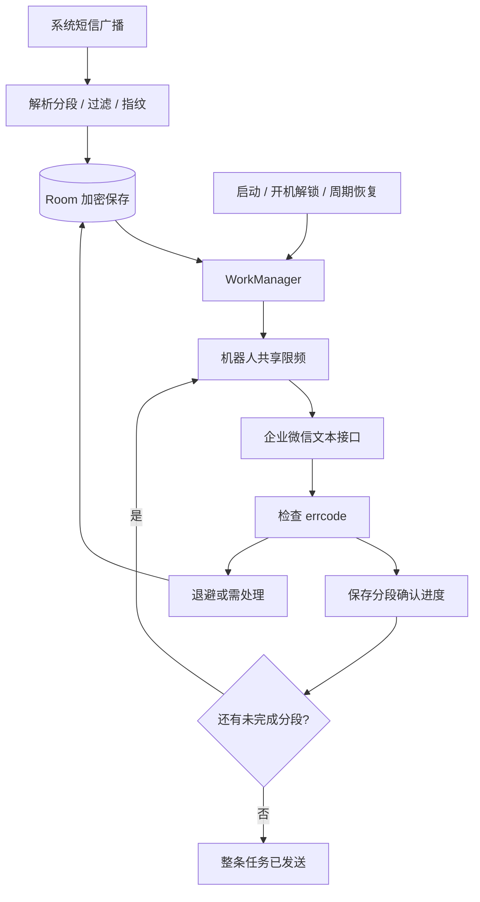

# 原生开发文档：企业微信机器人专用版

更新日期：2026-10-30。当前版本：0.3.2。短信外发通道为企业微信群机器人文本消息，eSIM 提醒可选择手机本地通知与企微。

## 1. 技术和工程基线

| 项目 | 配置 |
| --- | --- |
| 语言 / 界面 | Kotlin、Compose Material 3 |
| 最低 / 编译 / 目标 SDK | 26 / 37 / 36 |
| 目标设备 | Android 16 |
| 构建 | AGP 9.5.0、Gradle Wrapper 9.6.0、JDK 25 |
| 持久化 | Room 2.8.4、KSP、Preferences DataStore |
| 后台 / 网络 | WorkManager 2.11.2、OkHttp 4.12.0 |
| 加密 | Android Keystore、AES-GCM |
| 包名 | com.tyverse.smswebhook |

版本以 Gradle Version Catalog 为准。项目不依赖 Flutter、NDK 或全局 Gradle。不要将个人 SDK 路径、IDE 设置、密钥、APK、日志或参考仓库上传到 Git。

## 2. 核心流程



Receiver 使用 goAsync 和有界后台任务完成解析及落盘，不等待网络或 su 授权。Room 是投递真实状态，WorkManager 负责唤起；两者之间的入队缺口由恢复扫描修复。

## 3. 权限

- INTERNET、ACCESS_NETWORK_STATE：网络和任务约束。
- RECEIVE_SMS：运行时授权接收新短信。
- RECEIVE_BOOT_COMPLETED：重启恢复入口。
- POST_NOTIFICATIONS：可选故障提醒。
- 不申请 READ_SMS、SEND_SMS、联系人或通话权限。

短信接收器要求发送方具有 BROADCAST_SMS，防止普通应用注入伪造短信。收信使用 SMS_RECEIVED，不接管默认短信软件。权限、系统验证码保护和厂商限制仍需在真实设备核对。

## 4. 数据与状态

首版使用 messages 表保存短信及一个目标的投递：

- 原始发送方、短信时间、接收时间、可用的 subscriptionId。
- 稳定 UUID、PDU 指纹及唯一约束，不只按正文去重。
- 加密正文、加密目标快照、加密且固定的企微消息分段列表。
- state、attempts、nextAttemptAt、租约令牌、墙钟/单调时钟/启动次数。
- nextPartIndex：从 0 开始的下一待发送段；只在 errcode=0 后前移。
- lastHttpStatus、lastBusinessCode、脱敏错误。

状态流转：PENDING → IN_FLIGHT → SUCCEEDED，或 RETRY_WAIT / NEEDS_ATTENTION；短信暂停产生 PAUSED，卡片旧周期失效产生 CANCELLED。

0.3.0 增加独立的 `esim_cards` 与 `esim_reminder_events`，Room 版本为 3。保留 schema 1、2、3 和逐级迁移，`messages` 追加可空的 `cardId`、`cardRuleVersion` 用于校验卡片提醒有效性。卡片号码、运营商与备注使用 `CryptoStore` 加密，名称用于列表和通知展示。

卡片修改使用 `revision` 检测过时编辑；到期或提醒规则变化另递增 `ruleVersion`。续期在事务中从确认时间计算新到期日并使旧任务失效，名称或备注编辑不改变提醒版本。提醒事件在事务中创建，按卡片、规则版本、计划时间唯一；两个渠道分别保存结果，企微复用现有 `messages` 投递队列。

`EsimReminderWorker` 不设置网络约束，创建事件并发送本地通知；企微 Worker 单独等待网络、共享机器人限频和有界重试。事件未完成时不堆积后续重复提醒，错过时段仅补一条当前事件。每卡唯一延迟任务和 15 分钟周期扫描、启动/开机恢复共同修复入队缺口，不承诺精确到秒。

短信启停、调度标签及过滤仅作用于 `sms_broadcast`；卡片任务来源为 `esim_reminder`。企微发送前检查卡片仍存在、开关开启且规则版本有效；续期无法撤回已经发出的网络请求。通知使用卡片 ID 区分，并携带仅供应用内部使用的详情入口。

Worker 条件领取任务，完成及确认分段时匹配租约。旧执行者不能覆盖新状态；进程退出或跨重启后的过期租约由恢复扫描修复。每个 Worker 有有限运行预算，不为保活无限循环。

## 5. 企业微信接口

Release 仅接受 HTTPS、qyapi.weixin.qq.com、443、`/cgi-bin/webhook/send`，以及唯一且非空的 key 参数。禁止其他提供商、账号密码、fragment、多 key 或其他 query 参数。Debug 额外允许 localhost、127.0.0.1、10.0.2.2 的同协议本地模拟接口。

发送固定 JSON：`{"msgtype":"text","text":{"content":"..."}}`。地址中的 key 完成认证，不发送通用 Bearer/HMAC/Idempotency 请求头。

每段文本最多 2048 UTF-8 字节，包含标题、发送方、接收时间、订阅 ID、短编号和分段标记。按照 Unicode code point 切分，不丢正文或拆断代理对；段列表在落盘时固定，重试不重新格式化。

只有 HTTP 成功且整数 errcode=0 才确认成功。读取响应限制 16 KiB，异常或未确认不能记为成功。服务端 errmsg 不直接写日志或数据库，避免其中带入凭证；保留业务码和本地提示。

| 失败 | 策略 |
| --- | --- |
| 45009 | 共享机器人冷却至少约 60 秒 |
| -1 | 服务繁忙，退避 |
| 其他非零业务码 | 需处理 |
| 超时、连接异常、408/429/5xx | 有界重试 |
| 重定向、TLS 校验失败、错误 JSON | 明确失败，不绕过安全校验 |

DataStore 原子预留每个机器人 key 哈希对应的下次发送时刻，所有 Worker 共享、跨进程重启保留，正常预留间隔 3.1 秒。地址和原始 key 不用作明文偏好项名字。平台限频还受其他使用同一机器人的客户端影响。

参考 [企业微信机器人文档](https://developer.work.weixin.qq.com/document/path/91770) 和 [腾讯 CloudBase 的企微接口示例与错误处理](https://docs.cloudbase.net/recipes/connect-wecom-webhook-cloud-function)。

## 6. 重复与部分成功

群机器人没有本应用可用的客户端幂等键。持久化分段确认能避免已确认段的正常重发，但无法消除“服务端已处理、客户端未保存确认”的重复窗口，不宣称端到端恰好一次。

原配置重试保留 nextPartIndex。用户明确更换机器人时，重置进度，从第一段发送到新目标；同一地址重新保存不重置进度。界面提示原群可能已经收到部分消息。

## 7. 配置与升级

DataStore 保存转发开关、过滤规则、健康状态以及加密机器人地址。Keystore 不可用时明确报错，不静默重建数据。

0.1.0 → 0.2.0：

1. Room 版本 1 → 2，追加 nextPartIndex 和 lastBusinessCode，保留原数据和 schema 1。
2. 旧明文地址迁入密文项，删除旧通用 Token/HMAC 项。
3. 旧目标不符合企微格式时，自动关闭转发，提示重新配置。
4. 未完成旧 payload 首次执行时转换为固定企微文本分段；已完成任务不重发。

敏感应用数据禁止云备份和设备迁移。日志不包含机器人 key、完整 URL、正文或请求体。

## 8. 过滤与容量

过滤采用发送方完整匹配、正文包含与排除文字。组内“或”，发送方与包含组之间“且”，排除优先，空组放行。限制条件数和长度，不在接收链路运行任意正则。

不匹配的短信不保存正文，只累计过滤触发次数和原因。测试通知绕过过滤。待处理任务容量上限 10,000，超限明确报错，不覆盖旧待发数据。

成功正文/快照约 24 小时后清理，成功记录约 7 天后删除；失败/暂停任务保留。自动投递窗口默认 7 天，最多 20 轮；手动重试重新开始窗口。

## 9. 后台和 Root

以事件接收、持久化和可恢复任务为基础，界面无需常驻。开机广播只恢复调度，不启动界面或无限前台服务。周期恢复最小 15 分钟，不是精确定时。

RootController 仅封装固定、经过包名校验的 su 命令，提供授权检测与本应用 deviceidle 白名单添加/撤销。只撤销本应用记录的变更，不全局关闭 Doze 或 SELinux。

重启首次解锁后恢复完整处理；强行停止需要重新打开应用。Direct Boot、短信库补偿、Root 看门狗和厂商专属适配尚未实现，真实 ROM 需要长期验证。

## 10. 构建和测试

```powershell
.\gradlew.bat -PisolatedTestApp=true assembleDebug testDebugUnitTest lintDebug assembleDebugAndroidTest
# 在指定模拟器上安装 .qa APK / .qa.test APK 并运行测试。
# 或交给 Gradle 管理设备测试：
.\gradlew.bat -PisolatedTestApp=true connectedDebugAndroidTest
# 最后生成正常包名的 APK：
.\gradlew.bat assembleDebug assembleRelease
```

QA 包不覆盖正常应用。测试使用本地模拟接口和虚构短信；不向真实机器人发送消息。覆盖接口响应、地址保护、UTF-8 分段、部分成功续传、配置加密、旧设置迁移和 Room schema 升级。

GitHub 提交使用英文；不上传 tmp 参考仓库、IDE 状态、SDK 路径、APK、密钥、日志、测试数据库或 .local 诊断材料。
